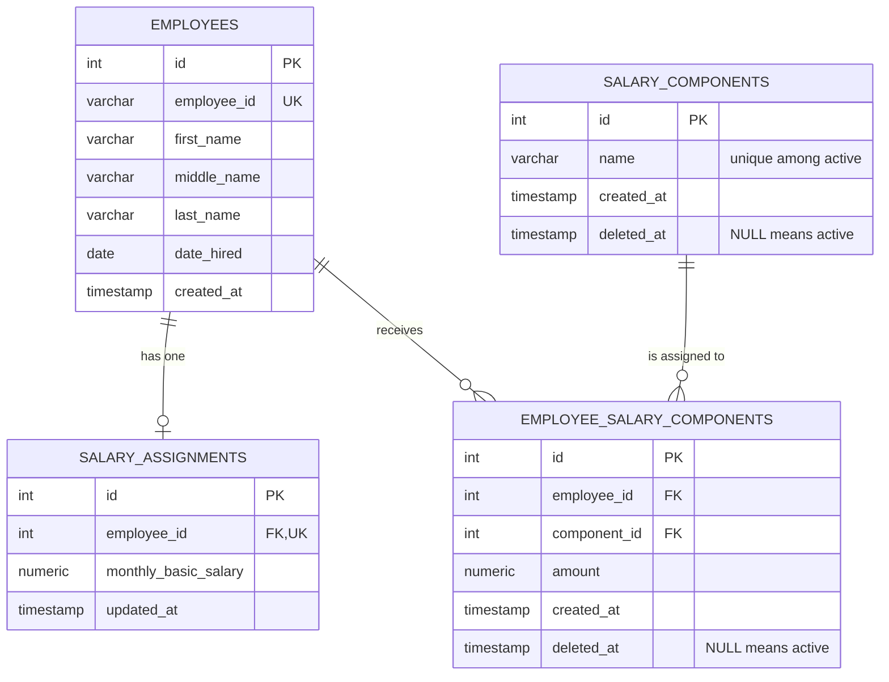

# Entity Relationship Diagram (ERD)

Paste this Mermaid diagram into https://mermaid.live/ or view this Markdown file in VS Code's Mermaid-enabled preview.

## Relationship explanation

- **EMPLOYEES → SALARY_ASSIGNMENTS:** One employee can have zero or one active salary record. `salary_assignments.employee_id` is a UNIQUE foreign key.
- **EMPLOYEES → EMPLOYEE_SALARY_COMPONENTS:** One employee can have many assigned component records.
- **SALARY_COMPONENTS → EMPLOYEE_SALARY_COMPONENTS:** A reusable component can be assigned to many employees.
- **EMPLOYEE_SALARY_COMPONENTS:** Junction table stores the amount **specific to each employee**.
- **Soft delete:** A component or employee component row is retained; `deleted_at` is set instead of issuing SQL DELETE.
- **Duplicate prevention:** Database-level partial unique index on the junction table prevents the same employee + component pair from appearing twice while active.

## Formula interpretation

All active component amounts are treated as **monthly additions** to monthly basic salary. There are no deduction types because the examination does not specify deduction rules.

- `total monthly salary = monthly basic salary + sum(active components)`
- `annual salary = total monthly salary × 12`
- `daily rate = annual salary ÷ 314`
- `hourly rate = daily rate ÷ 8`
- `per-minute rate = hourly rate ÷ 60`

The server computes using full precision and rounds each displayed result to two decimal places.
